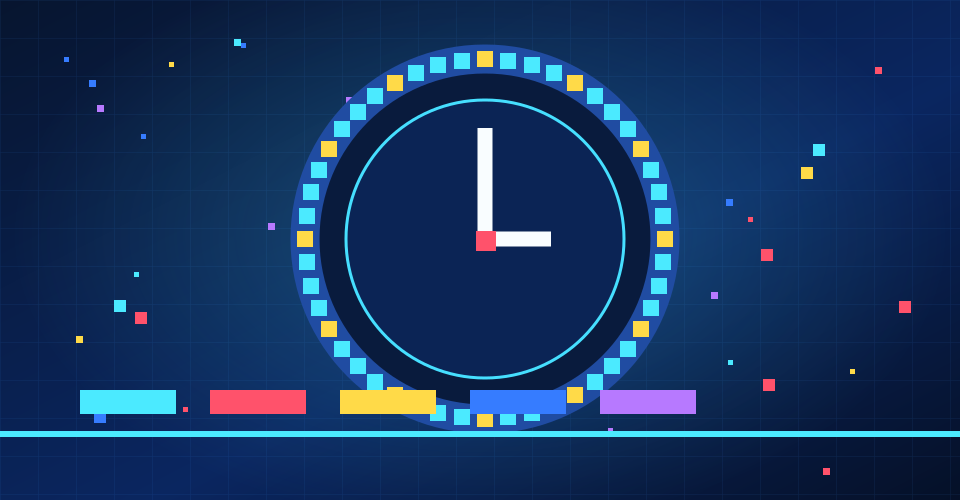
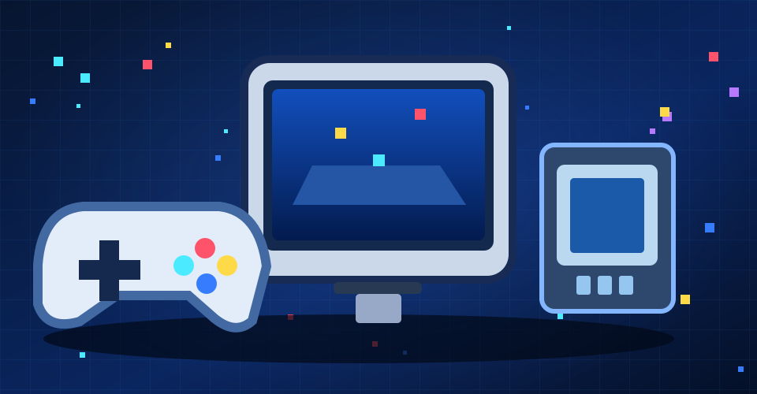
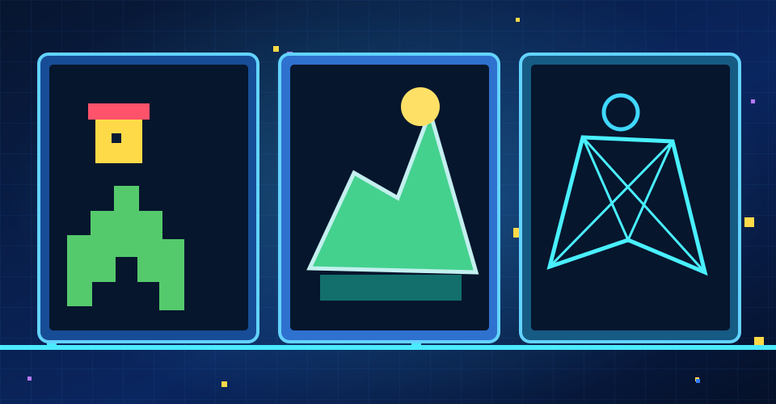
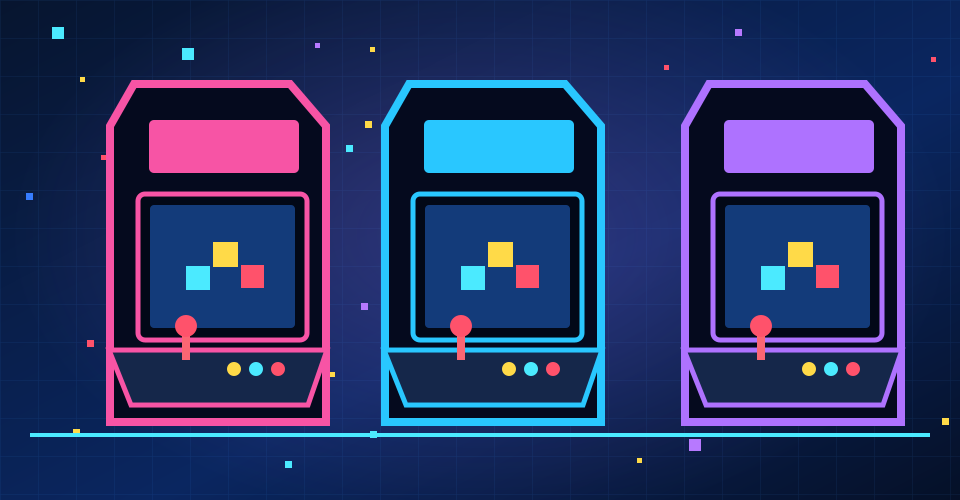
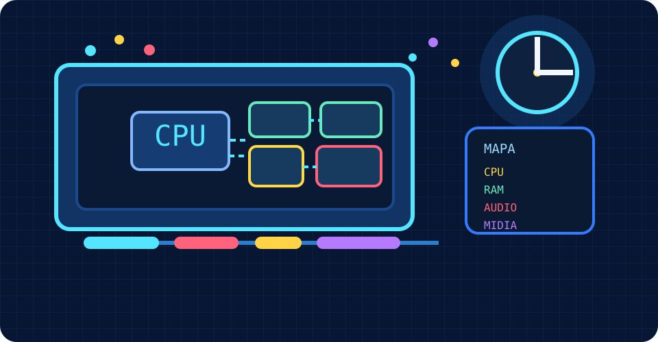

<div align="center">

# PIXEL - Museu Interativo dos Videogames

**Uma história feita de pixels. Memórias que nos conectam.**

<a href="https://igorbatistapdev.github.io/pixel-arcade/">
  
</a>

[**Explorar o museu**](https://igorbatistapdev.github.io/pixel-arcade/) · [**Código-fonte**](https://github.com/igorbatistapdev/pixel-arcade)


**Projeto acadêmico · Sistemas de Informação · Unilasalle-RJ**

</div>

---

## Sobre o PIXEL

O **PIXEL** é um museu digital interativo que explora a história dos videogames e sua relação com a **arte, a tecnologia, a cultura e a memória afetiva**.

Por meio de exposições visuais, jogos, comparações gráficas e atividades educativas, o projeto convida o visitante a descobrir como os videogames evoluíram e de que maneira influenciam nossas experiências, emoções e relações humanas.

<div align="center">

**6 salas** · **4 jogos interativos** · **24 questões** · **39 consoles catalogados**

</div>

---

## Explore o museu

Seis ambientes interativos para conhecer diferentes aspectos da história e da cultura dos videogames.

<table>
<tr>
<td width="50%" align="center">

<a href="https://igorbatistapdev.github.io/pixel-arcade/#/sala/linha-do-tempo">

</a>

**01 — Linha do tempo**

<sub>Origens, gerações e marcos históricos.</sub>

</td>
<td width="50%" align="center">

<a href="https://igorbatistapdev.github.io/pixel-arcade/#/sala/consoles">

</a>

**02 — Consoles**

<sub>Máquinas que marcaram gerações.</sub>

</td>
</tr>
<tr>
<td align="center">

<a href="https://igorbatistapdev.github.io/pixel-arcade/#/sala/evolucao-grafica">

</a>

**03 — Evolução gráfica**

<sub>Da pixel art aos mundos tridimensionais.</sub>

</td>
<td align="center">

<a href="https://igorbatistapdev.github.io/pixel-arcade/#/sala/mundos-dos-jogos">

</a>

**04 — PIXEL ARCADE**

<sub>Jogos clássicos e experiências interativas.</sub>

</td>
</tr>
<tr>
<td align="center">

<a href="https://igorbatistapdev.github.io/pixel-arcade/#/sala/quiz">

</a>

**05 — Quiz histórico**

<sub>Desafios e aprendizagem.</sub>

</td>
<td align="center">

<a href="https://igorbatistapdev.github.io/pixel-arcade/#/sala/por-dentro-do-console">

</a>

**06 — Hardware Lab**

<sub>Descubra a tecnologia por trás dos jogos.</sub>

</td>
</tr>
</table>

---

## Arte, cultura e experiências

Além das salas, a Home apresenta três experiências complementares:

**Sinta a arte dos games**  
Uma galeria sobre cores, movimento, imagens e diferentes sensações produzidas pelos jogos.

**Jogos contemporâneos, novas sensibilidades**  
Uma exposição visual que explora atmosferas, paisagens, narrativas e linguagens artísticas dos jogos contemporâneos.

**Memórias que nos conectam**  
Uma experiência interativa sobre nostalgia, descoberta, convivência e superação, mostrando como os videogames também fazem parte de nossas histórias pessoais.

---

## Sensibilidade e Estética

O PIXEL foi desenvolvido no contexto da **Atividade Integradora VI — Sensibilidade e Estética**, do curso de Sistemas de Informação da **Unilasalle-RJ**.

A proposta considera os videogames não apenas como produtos tecnológicos, mas também como **manifestações culturais e formas de expressão artística**, capazes de estimular a criatividade, despertar emoções e construir memórias coletivas.

O projeto estabelece conexões entre diferentes dimensões:

| Dimensão | Aplicação no museu |
|---|---|
| **Arte e estética** | Evolução gráfica, imagens e direção de arte. |
| **Sensibilidade** | Emoções e percepções despertadas pelos jogos. |
| **Cultura e memória** | História dos videogames e experiências compartilhadas. |
| **Tecnologia** | Consoles, programação e hardware. |
| **Educação** | Aprendizagem por meio de exposições e interatividade. |

**Objetivo:** aproximar a Computação da educação cultural, demonstrando como os videogames podem contribuir para a reflexão sobre arte, ciência, memória e relações humanas.

O museu é destinado a estudantes, visitantes e interessados na cultura dos videogames, com acesso pelo navegador e sem necessidade de cadastro.

### Registro acadêmico

**Instituição:** Unilasalle-RJ  
**Curso:** Sistemas de Informação  
**Componente curricular:** Atividade Integradora VI  
**Tema:** Sensibilidade e Estética  
**Professor(a) orientador(a):** [PREENCHER]  
**Apresentação e público participante:** [PREENCHER]

---

## Tecnologias

O projeto foi desenvolvido como uma aplicação web estática, sem backend.

| Tecnologia | Aplicação |
|---|---|
| **HTML5 / CSS3** | Estrutura, identidade visual e responsividade. |
| **JavaScript** | Navegação, animações e interatividade. |
| **JSON** | Organização dos conteúdos históricos. |
| **Canvas API** | Jogos e experimentos gráficos. |
| **SVG / WebP** | Ilustrações e imagens. |
| **GitHub Pages** | Publicação do museu. |

### Estrutura simplificada

```text
pixel-arcade/
├── index.html       # Página principal
├── assets/          # Imagens e identidade visual
├── css/             # Estilos e animações
├── js/              # Lógica e interatividade
├── data/            # Acervo e conteúdos em JSON
├── games/           # Jogos integrados
└── README.md        # Documentação
```

---

## Executar localmente

Clone o repositório:

```bash
git clone https://github.com/igorbatistapdev/pixel-arcade.git
cd pixel-arcade
```

Inicie um servidor local com Python:

```bash
python -m http.server 8000
```

No Windows, também é possível utilizar `py -m http.server 8000`.

Acesse **http://localhost:8000** no navegador.

---

## Acessibilidade e responsividade

O PIXEL possui layouts adaptáveis, controles por teclado e toque em recursos específicos, textos alternativos em imagens relevantes e suporte à preferência por movimento reduzido em determinadas animações.

Essas medidas não representam uma certificação de conformidade integral com padrões de acessibilidade.

---

## Referências

O acervo utiliza referências históricas e materiais de instituições e fabricantes, incluindo:

- [Computer History Museum](https://www.computerhistory.org/)
- [Nintendo — História](https://www.nintendo.co.jp/corporate/history/index.html)
- [PlayStation — História dos consoles](https://www.playstation.com/pt-br/playstation-history/)

Informações adicionais estão associadas aos conteúdos históricos do museu.

---

## Direitos autorais

O PIXEL é um **projeto acadêmico independente, sem finalidade comercial**, desenvolvido para fins educativos e culturais.

O projeto não possui vínculo oficial, patrocínio ou afiliação com as empresas e titulares das marcas apresentadas.

Personagens, jogos, logotipos, capturas de tela e demais materiais protegidos pertencem aos respectivos titulares. O uso educacional não representa autorização automática de redistribuição, e os jogos ou recursos de terceiros devem respeitar suas licenças específicas.

A ausência de finalidade comercial não dispensa o cumprimento dos direitos autorais. Eventual licença para o código autoral do PIXEL deverá ser definida separadamente.

---

<div align="center">


### Mais que jogos. Memórias que nos conectam.

**Desenvolvido por Igor Batista Pereira**

Sistemas de Informação · Unilasalle-RJ  
Atividade Integradora VI — Sensibilidade e Estética

[**Visitar o PIXEL**](https://igorbatistapdev.github.io/pixel-arcade/)

</div>
