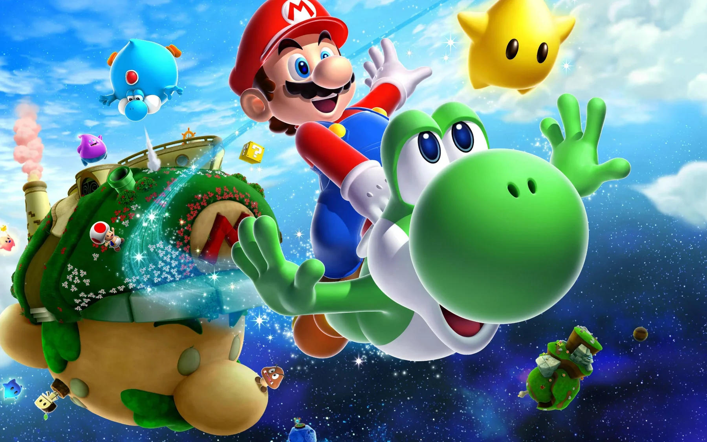
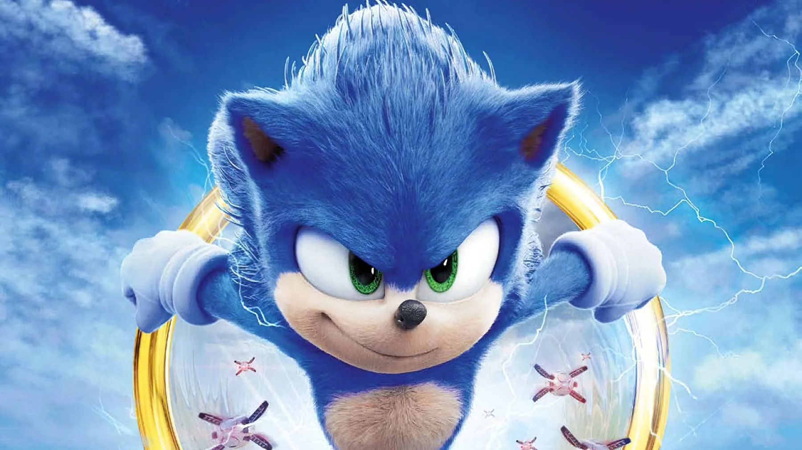
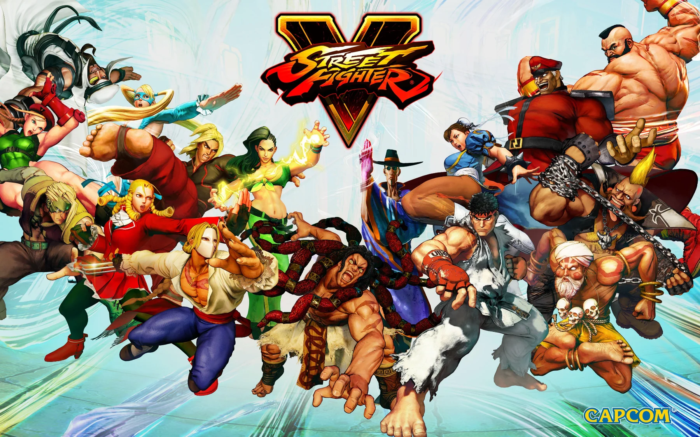
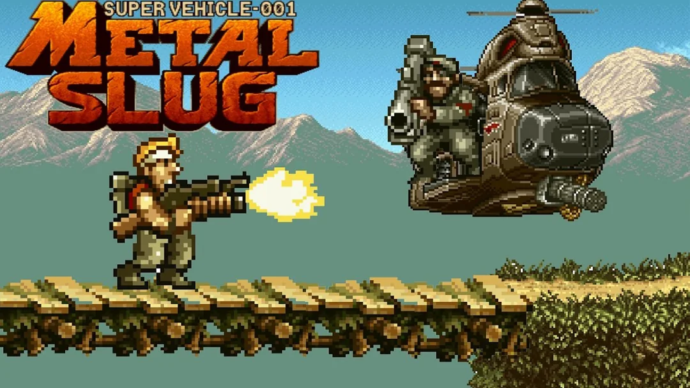
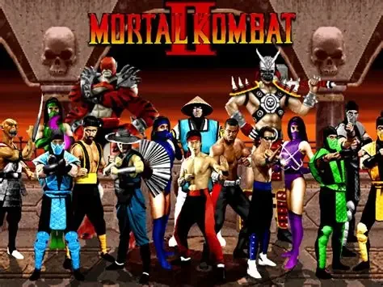
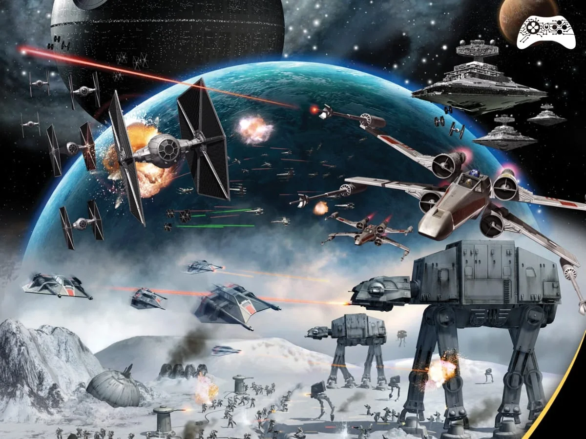
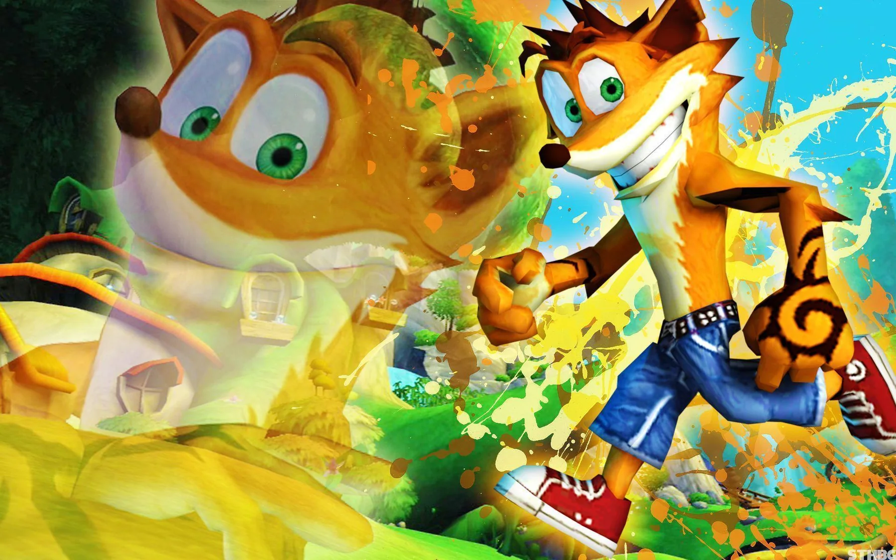
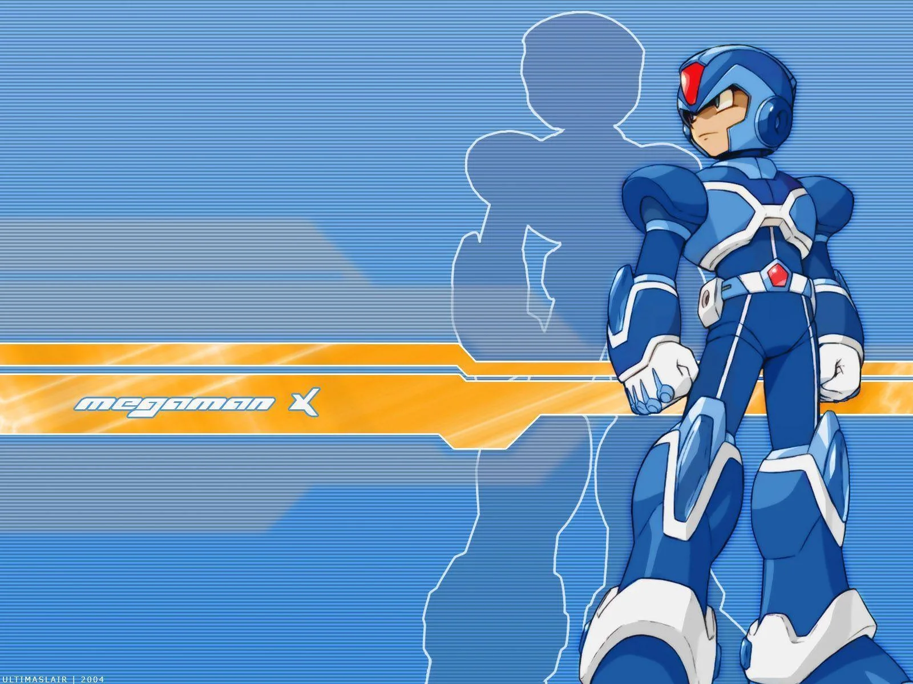
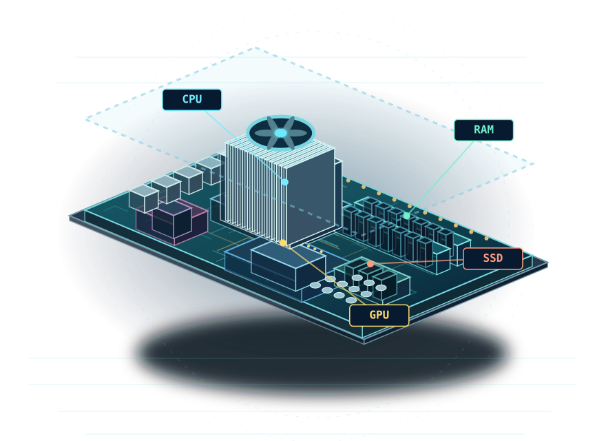

<div align="center">

  

  # PIXEL - Museu Interativo dos Videogames

  ### Mais que jogos. Memórias que nos conectam.

  Uma experiência digital para **explorar a história dos videogames**, compreender sua evolução e descobrir como a arte, a tecnologia e a memória afetiva transformam a maneira como sentimos e nos relacionamos com os jogos.

  [](https://github.com/igorbatistapdev/pixel-arcade)
  
  

  <br>

  
  
  
  
  

</div>

---

<div align="center">

**APRENDA · EXPLORE · JOGUE · SINTA**

## 🎮 Um museu que você não apenas visita. Você vive.

</div>

O **PIXEL** é um museu digital interativo dedicado à história e à cultura dos videogames. A proposta é transformar conteúdos históricos e tecnológicos em uma experiência **visual, acessível e participativa**, combinando exposições, comparações gráficas, jogos, desafios e experimentos sobre o funcionamento dos consoles.

Mas existe uma pergunta que acompanha toda a experiência:

> **Por que certos jogos continuam vivos na nossa memória, mesmo depois que desligamos o console?**

A resposta envolve mais que processadores ou resolução de tela. Envolve **arte, trilhas sonoras, personagens, descobertas, desafios, amizade, imaginação e sentimentos**.

O PIXEL parte desse encontro entre técnica e sensibilidade para mostrar que os videogames também são expressão cultural.

### ✨ O projeto em números

| 🏛️ 6 salas temáticas | 🕹️ 4 experiências no arcade | 🎓 24 questões no quiz | 🎨 8 artes no carrossel |
|:---:|:---:|:---:|:---:|
| História e experimentação | Jogos integrados ao museu | Aprendizado com explicações | Imagens e animações na home |

O acervo de consoles é alimentado pelo arquivo `data/consoles.json`, com **39 registros**.

---

# 🖼️ Jogos contemporâneos, novas sensibilidades

A Home apresenta uma exposição cinematográfica dedicada à **interpretação artística de jogos contemporâneos**, conectando composição, atmosfera, imaginação, narrativa e sensibilidade, em diálogo com a Atividade Integradora VI. **Não é uma sétima sala:** o visitante explora a exposição diretamente na Home, sem perder acesso às seis salas originais.

- **6 obras principais:** *Hollow Knight*, *Horizon Zero Dawn*, *Cyberpunk 2077*, *Marvel’s Spider-Man*, *The Last of Us* e *Minecraft*.
- **6 olhares complementares:** *Ghost of Tsushima*, *Assassin’s Creed*, *Halo*, *Red Dead Redemption*, *Resident Evil* e *Hogwarts Legacy*.
- **Interação:** ao selecionar uma imagem, abre-se um painel ampliado com comentário curatorial, pergunta de reflexão e acesso a uma sala relacionada. É possível fechar pelo botão, clicando no fundo ou pressionando `Esc`.
- **Galerias atualizadas:** a seção **Sinta a arte dos games** recebeu novas artes de *Sonic*, *Pokémon*, *Star Wars* e *Mortal Kombat*. **Memórias que nos conectam** usa imagens de *Fortnite*, *Mario*, *Zelda* e *God of War* para trabalhar convivência, nostalgia, descoberta e superação.
- **Interface:** mural responsivo, cores por temática, efeitos de profundidade, bordas luminosas, foco visível para teclado e respeito à configuração de movimento reduzido.

As **20 imagens enviadas para esta atualização** foram otimizadas em WebP dentro de `assets/contemporaneo-*.webp`. Os direitos autorais continuam pertencendo aos titulares das obras; o envio de imagens para a curadoria **não representa, por si só, licença para sua redistribuição pública**.

---

# 📚 Contexto acadêmico

| Informação | Descrição |
|---|---|
| **Instituição** | Unilasalle-RJ — Rio de Janeiro |
| **Curso** | Sistemas de Informação |
| **Responsável pelo repositório** | Igor Batista Pereira |
| **Componente curricular** | Atividade Integradora VI |
| **Eixo temático** | Sensibilidade e Estética |
| **Natureza** | Projeto acadêmico e educacional |
| **Finalidade** | Sem fins comerciais |
| **Formato** | Museu virtual interativo, acessível pelo navegador |

## 🎓 Por que videogames em Sensibilidade e Estética?

A estética não está restrita à pintura, à escultura ou ao cinema. Ela também se manifesta nas **cores, formas, sons, movimentos, interfaces e narrativas** que compõem um jogo digital.

Um videogame pode ser observado tanto como **produto de uma evolução tecnológica** quanto como **obra de expressão artística**.

A limitação de pixels nos primeiros consoles, por exemplo, influenciou decisões criativas de artistas e desenvolvedores. Com o avanço do hardware, surgiram novas possibilidades de composição, ambientação, iluminação, som e interatividade.

No contexto da **Atividade Integradora VI — Sensibilidade e Estética**, o PIXEL propõe conectar diferentes dimensões:

| Dimensão | Relação com o projeto |
|---|---|
| ❤️ **Sensibilidade** | Emoções, percepções e experiências despertadas pelos videogames |
| 🎨 **Estética** | Linguagens visuais, sonoras e narrativas dos jogos |
| 💭 **Memória afetiva** | Lembranças pessoais e coletivas associadas aos games |
| 🤝 **Cultura e convivência** | Relações sociais construídas dentro e fora das partidas |
| 💻 **Tecnologia** | Evolução dos consoles, do hardware e dos recursos computacionais |
| 📖 **Educação** | Aprendizagem por meio de exploração e experimentação |

> **Propósito acadêmico:** demonstrar, por meio de uma aplicação web, como a Computação pode contribuir para a divulgação cultural e para a construção de experiências educativas que valorizam a arte e a sensibilidade humana.

## 🎯 Objetivos do projeto

### Objetivo geral

Desenvolver um ambiente digital educativo e interativo que apresente a trajetória dos videogames e relacione sua evolução tecnológica à estética, à cultura e à memória afetiva.

### Objetivos específicos

1. Organizar marcos históricos de forma compreensível e acompanhada de referências.
2. Apresentar diferentes gerações de consoles e suas características.
3. Evidenciar mudanças na linguagem visual dos jogos por meio de comparações.
4. Promover aprendizagem ativa com jogos, desafios e atividades interativas.
5. Explicar conceitos de hardware de maneira visual e experimental.
6. Valorizar a dimensão artística e social dos videogames.
7. Oferecer uma experiência responsiva, sem exigir cadastro ou instalação.

---

# 🎨 Identidade visual — do pixel à emoção

A linguagem visual do PIXEL combina a atmosfera nostálgica dos fliperamas com uma interface digital contemporânea.

| Elemento | Identidade | Intenção |
|---|---|---|
| **Azul-petróleo profundo** | `#0B1E3A` | Criar profundidade e ambientação imersiva |
| **Ciano luminoso** | `#00C2FF` | Representar energia, tecnologia e movimento |
| **Amarelo arcade** | `#FFD200` | Destacar interações e referências retrô |
| **Pixel art e neon** | Geometria, luzes e animações | Remeter às origens dos jogos eletrônicos |
| **Galeria afetiva** | Composições coloridas | Valorizar imaginação, lembranças e emoção |

## 🖼️ Uma capa viva

Na página inicial, um **painel inspirado em um monitor de arcade** exibe automaticamente oito imagens de universos marcantes dos videogames.

O carrossel oferece:

- Reprodução automática;
- Transições suaves;
- Controles manuais;
- Brilhos e iluminação em neon;
- Raios e efeitos elétricos estilizados;
- Adaptação a diferentes tamanhos de tela.

<div align="center">

| | | | |
|:---:|:---:|:---:|:---:|
|  |  |  |  |
| **Mario** | **Sonic** | **Street Fighter** | **Metal Slug** |
|  |  |  |  |
| **Mortal Kombat** | **Star Wars** | **Crash** | **Mega Man X** |

</div>

## 💛 Sinta a arte dos games

Uma das propostas centrais do projeto é demonstrar que os videogames podem despertar diferentes sensações.

| ✨ Descoberta | ⚔️ Desafio | ⚡ Velocidade | 💛 Memória |
|:---:|:---:|:---:|:---:|
| Imaginar novos mundos | Persistir e superar obstáculos | Sentir ritmo e movimento | Recordar histórias e pessoas |

Essa área apresenta experiências visuais e referências a jogos conhecidos para convidar o visitante a refletir sobre como a arte digital influencia suas emoções.

## 💖 Memórias que nos conectam — experiência interativa

A Home conta com uma atividade curta de **reflexão sobre Sensibilidade e Estética**: o visitante responde à pergunta *“O que torna um jogo inesquecível para você?”* escolhendo uma entre quatro experiências:

| ✨ Descoberta | 💗 Nostalgia | 🤝 Convivência | 🏆 Superação |
|:---:|:---:|:---:|:---:|
| Imaginar o desconhecido | Recordar fases da vida | Compartilhar momentos | Aprender com desafios |

Cada opção atualiza um painel com **imagem, reflexão e caminho para outra sala**. É uma experiência de interpretação pessoal, **sem respostas certas ou erradas e sem transmissão ou armazenamento de respostas**. Sua finalidade é conectar histórias dos videogames à educação dos sentidos, à cultura e às relações humanas.

A identidade da Home foi aprimorada com **moldura neon cinematográfica, miniaturas selecionáveis no carrossel, cards ilustrados das seis salas, galeria de imagens coloridas, efeitos de luz e animações responsivas**. As imagens já pertencentes ao acervo foram preservadas; as novas ilustrações vetoriais originais aparecem em `assets/home-memory-scene.svg` e `assets/home-sunset.svg`.

---

# 🏛️ Explore as seis salas do museu

Cada sala oferece uma maneira diferente de conhecer os videogames: **observar, comparar, jogar, responder e experimentar**.

## 01 · Linha do Tempo — Uma história que continua


Uma viagem por marcos históricos, dos experimentos que antecederam os consoles aos sistemas que ampliaram a presença dos games no cotidiano.

### O que o visitante encontra?

- Linha do tempo interativa;
- Períodos importantes da história dos videogames;
- Datas e acontecimentos históricos;
- Filtros de navegação;
- Explicações e curiosidades;
- Referências para aprofundamento;
- Contextualização da evolução tecnológica.

A exposição procura distinguir experimentos, demonstrações, lançamentos comerciais e particularidades regionais quando aplicável.

**Rota:** `#/sala/linha-do-tempo`

---

## 02 · Galeria de Consoles — Máquinas que fizeram história


Um acervo pesquisável dedicado às plataformas que marcaram diferentes gerações.

### Funcionalidades

- Pesquisa de consoles;
- Fichas informativas;
- Fabricantes e anos de lançamento;
- Gerações de videogames;
- Características técnicas;
- Jogos representativos;
- Curiosidades históricas;
- Fontes e referências.

A base atual reúne **39 registros**, incluindo informações regionais quando documentadas.

**Rota:** `#/sala/consoles`

---

## 03 · Evolução Gráfica — Quando a imagem conta histórias


Uma exposição sobre como limitações e avanços técnicos influenciaram a direção de arte dos jogos — dos pixels e sprites às experiências tridimensionais e cinematográficas.

### Experiências disponíveis

- Exploração de diferentes linguagens visuais;
- Comparações entre períodos técnicos;
- Comparador de imagens com controle deslizante;
- Estudos sobre mudanças em franquias conhecidas;
- Conteúdo explicativo e histórico;
- Estudo de caso sobre a evolução visual de Sonic.

### Franquias utilizadas nas comparações

| Franquia | Proposta de análise |
|---|---|
| **Mario** | Evolução de cenários, personagens e cores |
| **Tomb Raider** | Transformação dos modelos e ambientes tridimensionais |
| **Star Wars** | Mudanças na representação de universos cinematográficos |
| **Street Fighter** | Evolução dos personagens e estilos de luta |
| **Grand Theft Auto** | Ampliação dos cenários e do detalhamento visual |

O objetivo não é apenas identificar qual jogo possui gráficos mais modernos, mas compreender **como diferentes tecnologias ampliaram as possibilidades artísticas dos desenvolvedores**.

**Rota:** `#/sala/evolucao-grafica`

---

## 04 · PIXEL ARCADE — A história também se joga


Inspirada nos fliperamas clássicos, essa sala transforma a visita ao museu em uma experiência jogável.

O ambiente apresenta um gabinete de arcade interativo, seleção de experiências e jogos acessíveis diretamente pelo navegador.

### 🕹️ Jogos disponíveis

| Jogo / experiência | Características |
|---|---|
| **Space Invaders** | Reflexos, pontuação e ação arcade |
| **Pac-Man** | Labirintos, coleta de pontos e estratégia |
| **OutRun JS** | Corrida em perspectiva pseudo-3D e estética retrô |
| **Open Sonic JS** | Plataforma lateral, velocidade e exploração |

### Recursos da sala

- Seleção de jogos;
- Interface inspirada em máquinas de fliperama;
- Jogos executados no navegador;
- Experiências interativas;
- Controles adaptados em partes do acervo;
- Recursos de pontuação e recordes locais quando disponíveis.

> **Por que incluir jogos jogáveis?** Porque compreender a história dos videogames também envolve experimentar suas mecânicas, suas limitações e as sensações produzidas pela interação.

**Rota:** `#/sala/mundos-dos-jogos`

---

## 05 · Quiz Histórico — Aprenda jogando


Uma experiência de aprendizagem ativa para testar o conhecimento adquirido durante a visita.

### Funcionalidades

- Banco com **24 questões**;
- Diferentes níveis de dificuldade;
- **Jornada Histórica:** 18 perguntas;
- **Desafio Rápido:** 10 perguntas;
- Alternativas e sistema de pontuação;
- Feedback para as respostas;
- Explicações educativas;
- Revisão dos erros;
- Conquistas e recordes locais;
- Cronômetro configurável;
- Suporte a atalhos de teclado.

A proposta do quiz não é simplesmente avaliar o visitante.

**Cada resposta representa uma oportunidade de descobrir algo novo sobre a história dos videogames.**

**Rota:** `#/sala/quiz`

---

## 06 · Por Dentro do Console — O laboratório dos videogames



Uma abordagem interativa da tecnologia que sustenta as experiências digitais.

### O que você pode explorar?

- Funcionamento básico da CPU;
- Memória e armazenamento;
- Processamento gráfico;
- Recursos de áudio;
- Evolução dos componentes;
- Representações visuais de hardware;
- Experimentos interativos;
- Comparações entre tecnologias.

### 🔬 Hardware Lab 3D

Uma experiência visual que permite explorar componentes e compreender suas funções.

### 🎮 Experimentos de renderização

O visitante pode modificar parâmetros de uma cena demonstrativa em Canvas para observar diferenças visuais e compreender conceitos relacionados ao processamento gráfico.

### 💎 Objetos e significados

Itens, ícones e elementos característicos dos jogos ajudam a demonstrar como pequenas representações visuais conseguem transmitir informações, emoções e significados.

> **Observação:** os experimentos de renderização possuem finalidade didática. Seus indicadores não representam benchmarks reais de consoles comerciais.

**Rota:** `#/sala/por-dentro-do-console`

---

# 🧠 A experiência que queremos provocar

O PIXEL não foi pensado apenas como uma sequência de páginas.

Seu percurso permite que visitantes de diferentes gerações façam conexões entre **o que os jogos eram**, **como se transformaram** e **o que significam para nós**.

```text
          DESCOBRIR
    Conhecer marcos e histórias
              │
              ▼
          OBSERVAR
    Perceber estilos e mudanças
              │
              ▼
          EXPERIMENTAR
       Interagir e jogar
              │
              ▼
           SENTIR
   Reconhecer emoções e memórias
              │
              ▼
         COMPARTILHAR
   Conversar sobre experiências
```

**Tecnologia** explica parte de como os jogos foram construídos.

**Arte e sensibilidade** ajudam a entender por que eles permanecem importantes para tantas pessoas.

---

# 🛠️ Tecnologias e arquitetura

O PIXEL foi desenvolvido como uma aplicação web **estática, modular e executada no navegador**, sem necessidade de banco de dados ou servidor de aplicação.

| Tecnologia | Utilização |
|---|---|
| **HTML5** | Estrutura das páginas e componentes |
| **CSS3** | Estilização, responsividade e animações |
| **JavaScript** | Navegação, interatividade, jogos e quiz |
| **JSON** | Organização dos dados e conteúdos históricos |
| **Canvas API** | Renderização e experimentos gráficos |
| **SVG** | Logotipos, ícones e ilustrações |
| **WebP** | Imagens otimizadas |
| **Git** | Controle de versões |
| **GitHub** | Hospedagem do repositório |
| **GitHub Pages** | Publicação estática do site |

## 📁 Estrutura do projeto

```text
pixel-arcade/
│
├── index.html                  # Página principal
├── README.md                   # Documentação
│
├── assets/                     # Imagens, capas e identidade visual
│   ├── pixel-logo-full.svg
│   ├── capa-mario.webp
│   ├── capa-sonic.webp
│   ├── home-memory-scene.svg
│   ├── home-sunset.svg
│   └── ...
│
├── css/                        # Estilos e animações
│   ├── main.css
│   ├── home-v5.css
│   ├── pixel-azul-petroleo.css
│   ├── pixel-home-artistic.css
│   ├── pixel-home-cinematic.css
│   ├── quiz.css
│   └── hardware-lab.css
│
├── js/                         # Lógica da aplicação
│   ├── app.js
│   ├── views.js
│   ├── navigation.js
│   ├── timeline.js
│   ├── consoles.js
│   ├── graphics.js
│   ├── arcade.js
│   ├── quiz.js
│   ├── inside-console.js
│   └── ...
│
├── data/                       # Conteúdos estruturados
│   ├── rooms.json
│   ├── timeline-events.json
│   ├── consoles.json
│   ├── graphics-evolution.json
│   └── quiz.json
│
└── games/                      # Experiências jogáveis
    ├── space-invaders/
    ├── pacman/
    ├── outrun/
    └── sonic/
```

---

# 🚀 Como executar o projeto

## Pré-requisitos

- Navegador atualizado;
- Python 3 ou outro servidor HTTP estático;
- Git, caso deseje clonar o repositório.

## 1. Clone o repositório

```bash
git clone https://github.com/igorbatistapdev/pixel-arcade.git
cd pixel-arcade
```

Se você baixou o projeto em ZIP, extraia o conteúdo e abra no terminal a pasta que contém o arquivo `index.html`.

## 2. Inicie o servidor local

### Windows — PowerShell

```powershell
py -m http.server 8000
```

### Linux ou macOS

```bash
python3 -m http.server 8000
```

## 3. Acesse no navegador

```text
http://localhost:8000
```

Pronto! Agora você pode explorar as salas, consultar o acervo, realizar o quiz e experimentar os jogos.

Para encerrar o servidor, pressione `Ctrl + C` no terminal.

> **Importante:** recomenda-se executar o projeto por um servidor HTTP local porque o JavaScript carrega módulos e dados JSON. Abrir diretamente o `index.html` pelo protocolo `file://` pode gerar restrições de acesso.

---

# 🌍 Publicação no GitHub Pages

O PIXEL pode ser hospedado como um site estático pelo GitHub Pages.

### Passo a passo

1. Acesse o repositório no GitHub.
2. Abra **Settings**.
3. Clique em **Pages**.
4. Em **Build and deployment**, selecione **Deploy from a branch**.
5. Escolha a branch `main`.
6. Selecione a pasta `/(root)`.
7. Salve as configurações.
8. Aguarde a conclusão da publicação.

O endereço esperado é:

```text
https://igorbatistapdev.github.io/pixel-arcade/
```

> O endereço acima somente estará disponível após a configuração e a conclusão da publicação no GitHub Pages.

---

# ♿ Responsividade e acessibilidade

O projeto busca oferecer uma experiência acessível e adequada a diferentes dispositivos.

### Cuidados adotados

- Interface responsiva;
- Adaptação para celulares, tablets e computadores;
- Navegação por botões e links identificáveis;
- Descrições em elementos visuais;
- Controles de teclado nas experiências em que foram implementados;
- Atenção à preferência por movimento reduzido;
- Pausa do carrossel durante determinadas interações;
- Conteúdos disponíveis sem cadastro.

A acessibilidade e a compatibilidade com dispositivos são aspectos de melhoria contínua e devem ser acompanhadas por testes práticos.

---

# 🔎 Referências históricas

A curadoria procura distinguir fatos documentados, marcos tecnológicos e interpretações sobre estética e cultura.

Entre as referências utilizadas no conteúdo histórico estão:

- [Computer History Museum — Graphics & Games](https://www.computerhistory.org/timeline/graphics-games/)
- [Nintendo — História da empresa](https://www.nintendo.co.jp/corporate/history/index.html)
- [Nintendo — História das consolas](https://www.nintendo.com/pt-pt/Consolas-e-acessorios/Historia-da-Nintendo/Historia-da-Nintendo-625945.html)
- [PlayStation — História dos consoles](https://www.playstation.com/pt-br/playstation-history/)

Outras referências específicas estão associadas aos registros das salas e aos arquivos disponíveis no diretório `data/`.

O acervo possui caráter educativo e não pretende representar de maneira exaustiva toda a história dos videogames.

---

# ⚖️ Direitos autorais e uso educacional

O **PIXEL é um projeto acadêmico independente, sem finalidade comercial**, desenvolvido para fins de estudo e apresentação educacional.

O projeto não representa, não é patrocinado e não possui vínculo oficial com Nintendo, Sega, Capcom, Bandai Namco, Sony, Microsoft, Disney/Lucasfilm ou outras empresas e titulares de marcas mencionadas.

### Materiais de terceiros

- Personagens, jogos, logotipos, capturas de tela e demais elementos protegidos pertencem aos respectivos titulares.
- As imagens utilizadas como referências visuais não representam autorização automática para redistribuição.
- Os jogos integrados ao museu podem utilizar código e recursos de projetos de terceiros.
- Os arquivos de licença e documentação de cada jogo devem ser consultados antes de sua reutilização ou republicação.
- A ausência de finalidade comercial não dispensa automaticamente o cumprimento dos direitos autorais.
- Qualquer licença de uso do código autoral do PIXEL deverá ser definida separadamente.

A proposta do projeto é exclusivamente educativa, cultural e acadêmica.

---

# 💛 O que torna o PIXEL especial?

O PIXEL procura unir **rigor histórico, exploração interativa e sensibilidade estética** em uma experiência que conversa com quem jogou no passado, com quem joga hoje e com quem está descobrindo esse universo pela primeira vez.

Não se trata apenas de comparar gráficos antigos com modernos ou conhecer especificações técnicas.

Trata-se de compreender que, por trás de cada tela, também existem **pessoas, criatividade, escolhas artísticas, emoções e histórias compartilhadas**.

A evolução dos videogames não pode ser medida apenas pela quantidade de pixels, pela potência de um processador ou pelo realismo de uma imagem.

Ela também está presente na capacidade que os jogos possuem de **criar lembranças, despertar sentimentos e conectar pessoas**.

---

<div align="center">

  ### 🟡 PRESS START TO REMEMBER

  **Os consoles mudam. As tecnologias evoluem. Algumas emoções permanecem.**

  <br>

  

  <br><br>

  **PIXEL · HISTÓRIA · ARTE · TECNOLOGIA · MEMÓRIA**

  <br>

  Desenvolvido no contexto da **Atividade Integradora VI — Sensibilidade e Estética**  
  **Sistemas de Informação · Unilasalle-RJ**

  <br>

  [⬆ Voltar ao início](#pixel--museu-interativo-dos-videogames)

</div>
