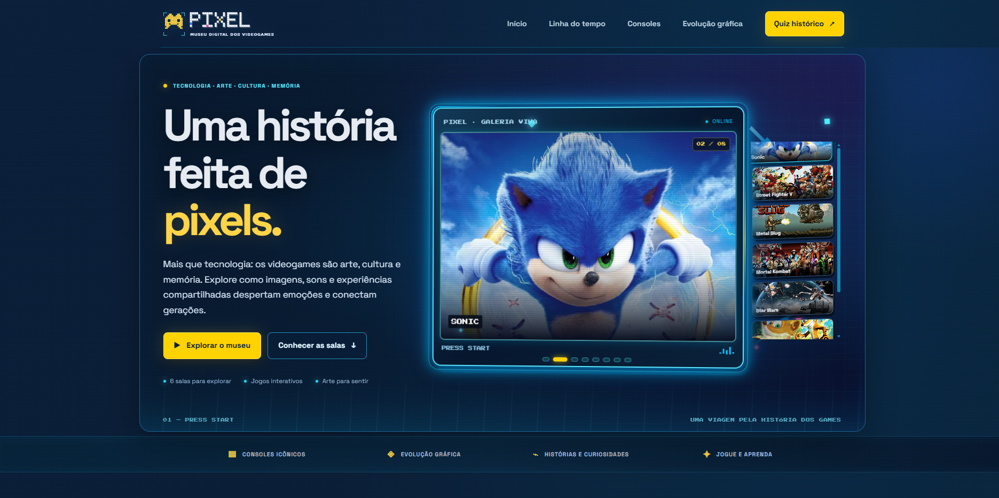
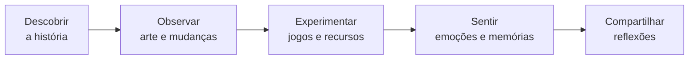
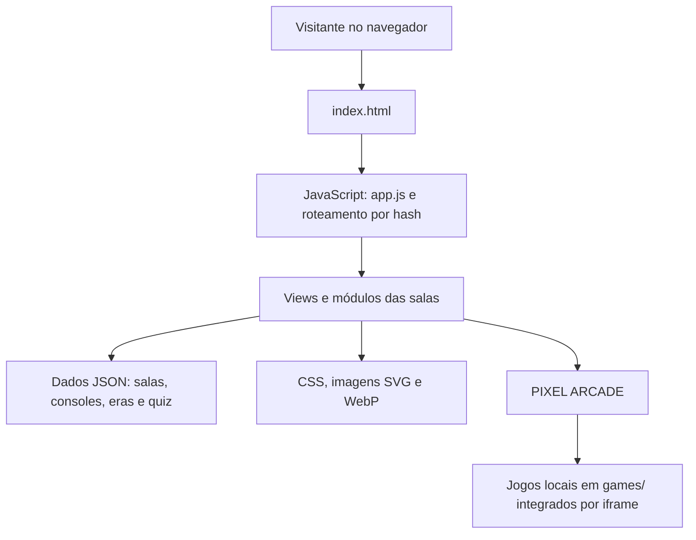
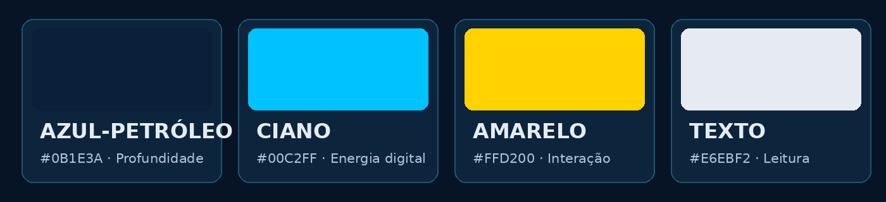

<div align="center">

# PIXEL — Museu Interativo dos Videogames

**Mais que jogos. Memórias que nos conectam.**

<a href="https://igorbatistapdev.github.io/pixel-arcade/"></a>

[**Abrir o projeto**](https://igorbatistapdev.github.io/pixel-arcade/) · [**Explorar o repositório**](https://github.com/igorbatistapdev/pixel-arcade)

  

**Atividade Integradora VI · Sistemas de Informação · Unilasalle-RJ**

</div>

---

## Visão geral

O **PIXEL** é um museu digital interativo dedicado à história e à cultura dos videogames. Por meio de exposições, comparações visuais, jogos e atividades educativas, aproxima **história, arte, tecnologia e memória afetiva**. O visitante é convidado a observar, experimentar e refletir sobre o significado cultural e humano dos jogos.

<div align="center">

</div>

## Panorama do museu

| Salas | Jogos no arcade | Questões no quiz | Artes no carrossel | Registros de consoles |
|:---:|:---:|:---:|:---:|:---:|
| **6** | **4** | **24** | **8** | **39** |

<sub>Dados descritos na versão documentada do projeto. O acervo de consoles está organizado em `data/consoles.json`; as experiências são acessíveis pelo navegador, sem cadastro.</sub>

## Galeria de telas

As imagens abaixo apresentam a **Home e as seis salas**. Cada captura deve ser produzida no próprio site, preferencialmente em tela desktop com os elementos da sala visíveis.

<div align="center">

<a href="https://igorbatistapdev.github.io/pixel-arcade/"></a>

**Home — entrada do museu e experiências de arte, história e memória**

<table>
<tr>
<td width="50%" align="center"><a href="https://igorbatistapdev.github.io/pixel-arcade/#/sala/linha-do-tempo"></a><br><strong>01 — Linha do tempo</strong><br><sub>Marcos da história dos videogames</sub></td>
<td width="50%" align="center"><a href="https://igorbatistapdev.github.io/pixel-arcade/#/sala/consoles"></a><br><strong>02 — Galeria de consoles</strong><br><sub>Plataformas e gerações</sub></td>
</tr>
<tr>
<td align="center"><a href="https://igorbatistapdev.github.io/pixel-arcade/#/sala/evolucao-grafica"></a><br><strong>03 — Evolução gráfica</strong><br><sub>Da pixel art aos mundos tridimensionais</sub></td>
<td align="center"><a href="https://igorbatistapdev.github.io/pixel-arcade/#/sala/mundos-dos-jogos"></a><br><strong>04 — PIXEL ARCADE</strong><br><sub>Space Invaders e outras experiências jogáveis</sub></td>
</tr>
<tr>
<td align="center"><a href="https://igorbatistapdev.github.io/pixel-arcade/#/sala/quiz"></a><br><strong>05 — Quiz histórico</strong><br><sub>Aprendizagem com perguntas e explicações</sub></td>
<td align="center"><a href="https://igorbatistapdev.github.io/pixel-arcade/#/sala/por-dentro-do-console"></a><br><strong>06 — Por dentro do console</strong><br><sub>Hardware, componentes e experimentação</sub></td>
</tr>
</table>

</div>

### Experiências adicionais da Home

A Home também inclui a galeria **Sinta a arte dos games**, a exposição **Jogos contemporâneos, novas sensibilidades** — com imagens ampliadas e comentários curatoriais — e **Memórias que nos conectam**, atividade com quatro escolhas reflexivas: descoberta, nostalgia, convivência e superação.

## Percurso do visitante



O percurso é uma **proposta pedagógica de visita**, não uma sequência obrigatória: as salas podem ser exploradas livremente.

## Estrutura do projeto

```text
pixel-arcade/
├── index.html               # Entrada da aplicação
├── README.md                # Documentação
├── assets/                  # Capas, capturas, SVGs e imagens
│   └── readme/              # Materiais visuais desta documentação
├── css/                     # Estilos, responsividade e animações
├── js/                      # Rotas, páginas e interações
│   ├── app.js
│   ├── views.js
│   ├── navigation.js
│   ├── timeline.js
│   ├── consoles.js
│   ├── graphics.js
│   ├── arcade.js
│   ├── quiz.js
│   └── ...
├── data/                    # Arquivos JSON do acervo
│   ├── rooms.json
│   ├── timeline-events.json
│   ├── consoles.json
│   ├── graphics-evolution.json
│   └── quiz.json
└── games/                   # Jogos integrados ao museu
    ├── space-invaders/
    ├── pacman/
    ├── outrun/
    └── sonic/
```

## Arquitetura e funcionamento



O PIXEL é uma **aplicação estática**, desenvolvida com HTML, CSS e JavaScript. A navegação entre as salas utiliza endereços com `#/sala/...`; o conteúdo estruturado está em arquivos JSON. **Não há backend nem banco de dados de aplicação.**

---

## Relação com a Atividade Integradora VI

### Sensibilidade e Estética: arte, ciência e cultura

O projeto foi desenvolvido no contexto da **Atividade Integradora VI — Sensibilidade e Estética**, do curso de **Sistemas de Informação da Unilasalle-RJ**. Sua proposta está ligada à área de **Cultura, Educação e Comunicação** e interpreta os videogames como manifestações da cultura visual e digital, que articulam **expressão artística, conhecimento técnico e experiência humana**.

Ao explorar sons, imagens, movimentos, narrativas e interações, o visitante pode refletir sobre como uma linguagem criada pela Computação também mobiliza **percepções, imaginação, afetos e relações sociais**.

> **Questão central:** como os videogames, além de produtos tecnológicos, podem ser compreendidos como experiências estéticas e referências da memória cultural?

### Dimensões formativas

| Dimensão | Onde aparece no PIXEL | Contribuição educativa |
|---|---|---|
| **Sensibilidade** | Sinta a arte dos games; exposição contemporânea | Perceber atmosfera, composição, movimento e sensações |
| **Estética** | Sala 03 — Evolução gráfica | Comparar linguagens artísticas e escolhas visuais |
| **Memória afetiva** | Memórias que nos conectam | Refletir sobre lembranças e experiências pessoais |
| **Cultura e convivência** | Sala 01; atividade de memórias | Compreender os jogos como referências sociais e culturais |
| **Tecnologia** | Sala 02 e Sala 06 | Relacionar hardware e programação à experiência audiovisual |
| **Educação** | Sala 04 — Arcade; Sala 05 — Quiz | Aprender por experimentação, desafio e reflexão |

### Patrimônio cultural e memória

A linha do tempo e a galeria de consoles organizam referências da história dos videogames, apresentando objetos, jogos e transformações técnicas que também marcam hábitos, linguagens e gerações. O projeto **não reivindica reconhecimento patrimonial formal** para o acervo: utiliza o conceito de patrimônio cultural como perspectiva de estudo e valorização dessas memórias.

### Vivência estética

A exposição **Jogos contemporâneos, novas sensibilidades** relaciona cenas de diferentes jogos a temas como silêncio, contemplação, movimento, narrativas e identidade visual. O visitante pode abrir uma imagem, ler um comentário curatorial e considerar uma pergunta reflexiva — sem a necessidade de uma resposta certa.

### Convivência e experiência humana

Em **Memórias que nos conectam**, o visitante escolhe entre descoberta, nostalgia, convivência e superação. O conteúdo muda para apresentar uma reflexão associada à escolha. Essa atividade **não coleta nem armazena respostas pessoais**.

## Objetivos do projeto

**Objetivo geral:** desenvolver um museu digital interativo que apresente a história dos videogames e conecte sua evolução tecnológica à arte, à cultura e à sensibilidade humana.

**Objetivos específicos:**

1. Organizar marcos históricos, plataformas e referências documentadas.
2. Apresentar diferentes expressões visuais e sua evolução técnica.
3. Estimular a observação e a reflexão por meio de exposições interativas.
4. Promover aprendizagem ativa com jogos e quiz histórico.
5. Explicar conceitos de hardware e Computação de forma visual.
6. Valorizar memória afetiva, criatividade e experiências compartilhadas.
7. Facilitar o acesso ao acervo por meio de um site responsivo e sem cadastro.

## Público-alvo e uso educacional

O museu é pensado para **estudantes, visitantes interessados em videogames e pessoas de diferentes gerações**. Pode apoiar apresentações acadêmicas e atividades educativas em escolas, mediante mediação e adequação ao público.

O acesso ocorre pelo navegador. **Não é necessário criar uma conta**, instalar um aplicativo ou disponibilizar informações pessoais para explorar as seções públicas.

## Contribuição da Computação

O curso de Sistemas de Informação contribui para a organização e a apresentação do conhecimento por meio de **dados estruturados, interfaces e interatividade**:

| Recurso técnico | Aplicação cultural e educativa |
|---|---|
| **JSON** | Organização de marcos, consoles e perguntas em dados reutilizáveis |
| **JavaScript e roteamento** | Visita entre salas e atualização dos conteúdos sem backend |
| **Canvas e jogos** | Experimentação direta de linguagens interativas |
| **HTML e CSS responsivo** | Consulta do acervo em diferentes tamanhos de tela |
| **GitHub Pages** | Publicação do site estático por endereço acessível na web |

## Rigor histórico e curadoria

O projeto procura distinguir três naturezas de conteúdo:

| Tipo | Como deve ser interpretado |
|---|---|
| **Fatos documentados** | Datas, eventos e especificações apoiados por fontes identificadas |
| **Interpretações curatoriais** | Leituras sobre estética, cultura e emoções propostas para reflexão |
| **Criações do PIXEL** | Ilustrações, textos autorais, interfaces e experimentos didáticos |

As comparações visuais têm propósito educativo e não pretendem medir objetivamente o valor artístico de jogos diferentes. A linha do tempo é seletiva; **não representa um inventário exaustivo** da história dos videogames.

## Registro da atividade de extensão

| Campo | Registro |
|---|---|
| Professor(a) orientador(a) | **[PREENCHER]** |
| Turma / período | **[PREENCHER]** |
| Data de apresentação | **[PREENCHER]** |
| Local ou modalidade da ação | **[PREENCHER]** |
| Público participante / atingido | **[PREENCHER]** |
| Atividades realizadas com o público | **[PREENCHER]** |
| Registro de avaliação ou devolutiva | **[PREENCHER]** |

*O preenchimento depende da realização e do registro efetivo das atividades. A publicação do repositório, por si só, não comprova alcance de público ou validação institucional.*

---

## Identidade visual

<div align="center">

</div>

A interface combina **referências à pixel art e aos fliperamas** com um tratamento digital contemporâneo. Utiliza tipografia de inspiração arcade nos destaques e texto de leitura contínua com fontes modernas, além de efeitos luminosos e animações discretas. Entre as fontes utilizadas no projeto estão **Press Start 2P** e **Space Grotesk**.

## Tecnologias utilizadas

   

| Tecnologia | Finalidade |
|---|---|
| HTML5 | Estrutura semântica das páginas |
| CSS3 | Layout, identidade, animações e responsividade |
| JavaScript | Navegação, conteúdo dinâmico, quiz e interações |
| JSON | Organização do acervo e das perguntas |
| Canvas API | Experimentos gráficos e experiências interativas |
| SVG e WebP | Ilustrações vetoriais e imagens otimizadas |
| Git / GitHub | Versionamento e repositório |
| GitHub Pages | Hospedagem do site estático |

## Como executar localmente

**Requisitos:** navegador atualizado e Python 3 (ou outro servidor HTTP estático). Git é necessário apenas para clonar o repositório.

**1. Obtenha os arquivos:**

```bash
git clone https://github.com/igorbatistapdev/pixel-arcade.git
cd pixel-arcade
```

**2. Inicie um servidor HTTP na pasta que contém `index.html`:**

Windows (PowerShell):

```powershell
py -m http.server 8000
```

Linux ou macOS:

```bash
python3 -m http.server 8000
```

**3. Acesse:** http://localhost:8000

Para interromper, pressione `Ctrl + C` no terminal. Abrir `index.html` diretamente por `file://` pode impedir o carregamento de módulos e arquivos JSON.

## Publicação no GitHub Pages

1. Abra o repositório no GitHub e entre em **Settings → Pages**.
2. Em **Build and deployment**, escolha **Deploy from a branch**.
3. Selecione `main` e `/(root)` e salve.
4. Aguarde a conclusão da publicação e abra o endereço do projeto.

**Site:** https://igorbatistapdev.github.io/pixel-arcade/

## Acessibilidade e responsividade

O PIXEL possui recursos voltados à navegação e à adaptação da interface, incluindo:

- Layouts responsivos para diferentes tamanhos de tela.
- Botões e links identificáveis, com textos alternativos em imagens relevantes.
- Interações por teclado em recursos específicos e controles por toque em partes do arcade.
- Respeito à preferência por movimento reduzido em animações implementadas com esse suporte.
- Controles do carrossel e pausa durante determinadas interações.
- Acesso público às seções do museu sem cadastro.

Esses recursos **não equivalem a uma certificação de conformidade integral com WCAG**. Compatibilidade, contraste e usabilidade devem continuar sendo testados em dispositivos e navegadores reais.

## Referências históricas

Fontes indicadas no acervo e no README de referência:

- [Computer History Museum — Graphics & Games](https://www.computerhistory.org/timeline/graphics-games/)
- [Nintendo — História da empresa](https://www.nintendo.co.jp/corporate/history/index.html)
- [Nintendo — História das consolas](https://www.nintendo.com/pt-pt/Consolas-e-acessorios/Historia-da-Nintendo/Historia-da-Nintendo-625945.html)
- [PlayStation — História dos consoles](https://www.playstation.com/pt-br/playstation-history/)

Referências adicionais estão associadas aos registros do acervo e aos arquivos no diretório `data/`.

## Direitos autorais e uso educacional

O **PIXEL é um projeto acadêmico independente, sem finalidade comercial**, desenvolvido para fins de estudo e apresentação educacional.

O projeto não representa, não é patrocinado e não possui vínculo oficial com Nintendo, Sega, Capcom, Bandai Namco, Sony, Microsoft, Disney/Lucasfilm ou outras empresas e titulares de marcas mencionadas.

### Materiais de terceiros

- Personagens, jogos, logotipos, capturas de tela e demais elementos protegidos pertencem aos respectivos titulares.
- As imagens utilizadas como referências visuais não representam autorização automática para redistribuição.
- Os jogos integrados ao museu podem utilizar código e recursos de projetos de terceiros.
- Os arquivos de licença e documentação de cada jogo devem ser consultados antes de sua reutilização ou republicação.
- A ausência de finalidade comercial não dispensa automaticamente o cumprimento dos direitos autorais.
- Qualquer licença de uso do código autoral do PIXEL deverá ser definida separadamente.

A proposta do projeto é exclusivamente educativa, cultural e acadêmica.

## Créditos acadêmicos

<div align="center">


**PIXEL — Museu Interativo dos Videogames**

**Igor Batista Pereira**  
Sistemas de Informação · Unilasalle-RJ  
Atividade Integradora VI — Sensibilidade e Estética

**Os consoles mudam. As tecnologias evoluem. Algumas emoções permanecem.**

[**Visitar o museu**](https://igorbatistapdev.github.io/pixel-arcade/) · [**Voltar ao início**](#pixel--museu-interativo-dos-videogames)

</div>
